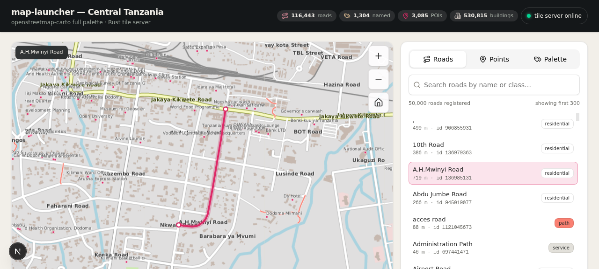

# map-launcher

A pure-Rust map launcher + tile server for **Central Tanzania (Dodoma)**, styled
with the complete **openstreetmap-carto** palette and symbol set, with a
Next.js preview UI inspired by [craft-launcher](https://github.com/storytold/craft-launcher).



## Components

| Component | Path | What it does |
| --- | --- | --- |
| `carto-math` | `mini-services/map-launcher/crates/carto-math` | Web-Mercator math, tile math, Cohen–Sutherland line clip, Sutherland–Hodgman polygon clip, Douglas–Peucker simplification |
| `carto-style` | `mini-services/map-launcher/crates/carto-style` | Full CartoCSS/MSS lexer + parser (`lighten/darken/fade/spin/mix/saturate/greyscale`), 55-role palette registry from the vendored `.mss` files, SVG symbol registry, system font loader |
| `carto-core` | `mini-services/map-launcher/crates/carto-core` | OSM PBF extractor (osmpbf) → bincode store: roads (with `oneway`, `lanes`, `maxspeed`), railways, waterways, buildings, landuse, POIs |
| `tile-server` | `mini-services/map-launcher/crates/tile-server` | Pure-Rust HTTP daemon (`:3100`): server-side carto-rendered tiles z0–z19, roads/POI/palette registries, oneway direction arrows (roads.mss `::directions`), LRU tile cache |
| preview UI | `src/` | Next.js 16 slippy map (z5–z19), roads registry with search + lane/direction/speed info, POI registry, live palette browser, versioned screenshot strip |
| vendored upstream | `vendor/` | [openstreetmap-carto](https://github.com/openstreetmap-carto/openstreetmap-carto) and [craft-launcher](https://github.com/storytold/craft-launcher) as git submodules |

## Fonts

Font importing follows the craft-launcher pattern
(`crates/ui-egui/src/theme.rs` + `cjk_font.rs`):

1. bundled faces in `assets/fonts` (DejaVu Sans regular + bold) are the guaranteed baseline,
2. system font directories are scanned per-OS — Windows `%SystemRoot%\Fonts`,
   macOS `/System/Library/Fonts`, Linux `/usr/share/fonts` — matching the family
   by normalized name and preferring Regular/Bold faces,
3. family priority mirrors openstreetmap-carto `style/fonts.mss`: **Noto Sans**
   first, then DejaVu Sans, then any bundled face.

## Data pipeline

```sh
cd mini-services/map-launcher
# 1. download the Geofabrik Tanzania extract (~700MB)
curl -L -C - -o data/tanzania-latest.osm.pbf \
  https://download.geofabrik.de/africa/tanzania-latest.osm.pbf
# 2. extract the Central-Tanzania bbox -> data/store.bin + registry.json
./target/release/tile-server extract data/tanzania-latest.osm.pbf data
# 3. serve tiles + registries on :3100
./target/release/tile-server serve --port 3100
```

`scripts/dev.sh` chains build → extract-on-first-run → serve.

## Releases (run on Windows / Linux without building)

Tagged releases (`v*`) are built by `.github/workflows/release.yml` on
**both** ubuntu-latest and windows-latest and publish a GitHub Release with:

| Asset | Contents |
| --- | --- |
| `tile-server-vX-windows-x64.zip` | `tile-server.exe` + README — **self-contained**: full openstreetmap-carto palette, symbols and DejaVu fonts are embedded in the binary |
| `tile-server-vX-linux-x64.tar.gz` | same for Linux |
| `map-launcher-web-vX.zip` | standalone Next.js preview UI — run `node server.js` (Node 20+) |
| `map-data-vX.zip` | Central Tanzania / Dodoma `store.bin` + `registry.json` — unzip into `data\` next to the exe |
| `*.sha256` | checksums |

Windows quickstart: unzip the three assets into one folder, double-click
`tile-server.exe`, then `node server.js` inside `web\`, open
<http://localhost:3000>. The web UI proxies tile-server traffic through its
own API routes (`/api/*`, `/tile/*`), so no gateway is needed locally.

## API (tile-server :3100)

Same endpoints are available through the Next.js proxy routes
(`/api/*`, `/tile/*` — used by the preview UI) and directly from the daemon:

- `GET /api/stats` — registry counts + bbox
- `GET /api/roads?limit=N` — roads registry (named first, includes `oneway`, `lanes`, `maxspeed`)
- `GET /api/roads/{id}` — road geometry + direction/lanes/speed facts
- `GET /api/pois?limit=N` — POI registry
- `GET /api/palette` — parsed openstreetmap-carto palette (roles → hex)
- `GET /tile/{z}/{x}/{y}.png` — server-rendered carto tile (z ≤ 19)

## Rendering (openstreetmap-carto faithful)

- all 19 `.mss` files parsed from `assets/style`, `road-colors.yaml` included
- landcover (forest/farmland/grass/scrub/residential/retail/…), water areas + waterways,
  buildings with z15 outlines, railways, per-class road casings + fills with low-zoom colors
- road-name labels with halo + per-class shield colors (z13+)
- **oneway direction arrows** from z16 — `symbols/oneway.svg` semantics:
  180px spacing along the line, per-class `@*-oneway-arrow-color`
  (`darken(casing, 10–40%)`), flipped for `oneway = -1`
- POI dots + labels, deep zoom to z19 with zoom-continuing width ramps

## Embedded assets

Release binaries boot anywhere (no repository checkout): `carto-style`
embeds the verbatim `assets/style/*.mss` (19 openstreetmap-carto style
sheets), the full `assets/symbols` tree and the DejaVu fonts with
`include_dir`. An on-disk `assets/` directory always takes precedence so
development stays overridable. Font loading follows the craft-launcher
pattern with per-OS system scans (Windows falls back to Segoe UI / Arial
before the embedded DejaVu bytes).

## CI

`.github/workflows/build.yml` builds and tests the whole Rust workspace on
**ubuntu-latest** and **windows-latest** (submodules checked out recursively,
release binaries uploaded as artifacts) and lints/builds the Next.js UI.
`.github/workflows/release.yml` builds the tagged releases (Linux + Windows
binaries + standalone web bundle) and publishes them to GitHub Releases.

## Screenshots

Versioned under `mini-services/map-launcher/screenshots/<version>/` and listed
by the UI's screenshot strip (`/api/screenshots`).

---

Data © OpenStreetMap contributors · style: openstreetmap-carto (MSS palette
vendored) · renderer: Rust carto-core + tiny-skia · UI inspired by craft-launcher.
